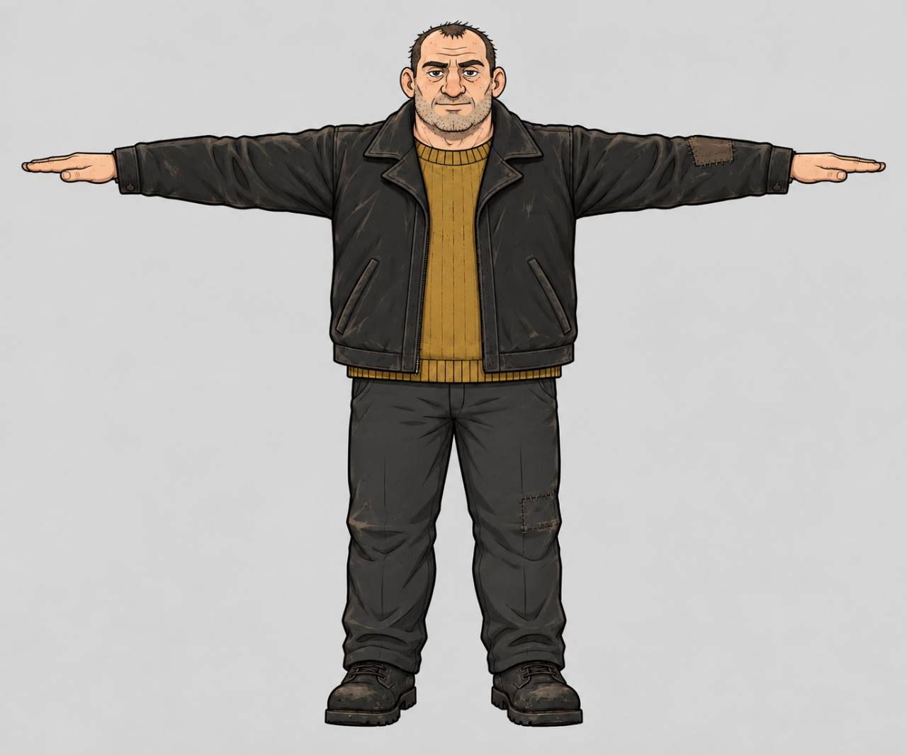
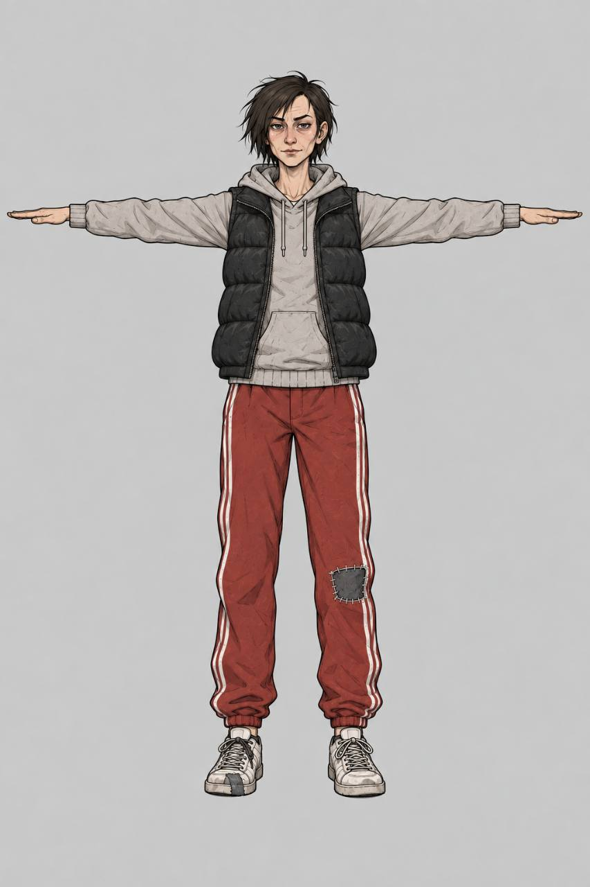
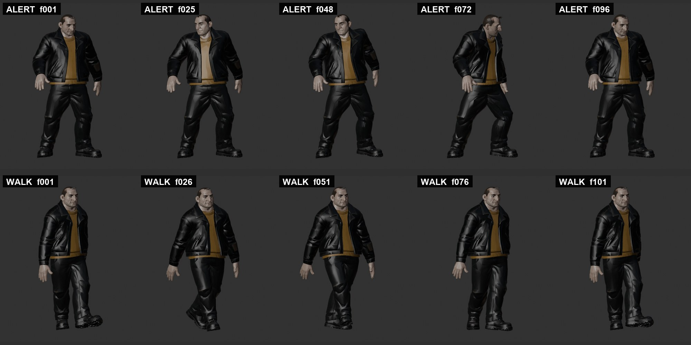
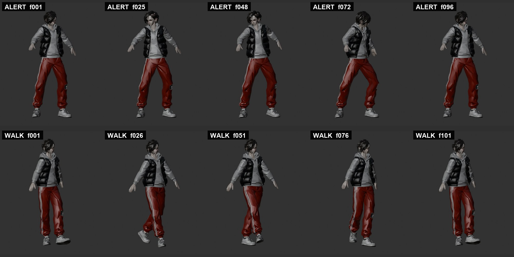

# Current fighter pilot poses

These are the two owner-supplied **new-pose** concepts for the Meshy fighter
pilot. Existing T-poses elsewhere in `concepts-3d/` are older work and are not
substitutes for this pair.

| ID | Source | State |
|---|---|---|
| F01 heavy bruiser | [`f01-heavy-bruiser-tpose-v01.jpg`](f01-heavy-bruiser-tpose-v01.jpg) | 2D concept approved; corrected v02 body/own-rig clips are current public playable-test derivatives; v01 is rollback; final art approval open |
| F02 wiry skirmisher | [`f02-wiry-skirmisher-tpose-v01.jpg`](f02-wiry-skirmisher-tpose-v01.jpg) | 2D concept approved; corrected v02 body/own-rig clips are current public playable-test derivatives; v01 is rollback; final art approval open |

## F01 heavy bruiser

## F02 wiry skirmisher

## Rig and animation review

These compressed contact sheets are pre-v02 evidence sampled from the original
Meshy Alert and Casual Walk outputs. The v02 proportion/material correction is
reviewed through PR #68's playable browser test and its full Blender QA rather
than represented by these older stills.
The public repository contains only the optimized v01 rollback and current v02
playable-test GLBs. Raw Meshy outputs, FBXs, editable Blender sources,
full-resolution renders, and detailed validation reports remain in the ignored
private workspace.

The v02 bodies retain 15,512/15,503 triangles, 24-bone skins, and 2K textures.
Their F01/F02 arm factors are `0.953`/`1.080`, producing mean
shoulder-to-wrist/height ratios of `0.319953`/`0.250006`; material payloads are
non-emissive with metallic `0`, roughness `0.92`, and specular factor `0.5`.

Do not treat concept approval or browser-test registration as production
approval. Generation task IDs, credit usage, fingerprints, Blender deformation
findings, browser-test scope, and remaining gates are recorded in
[`../../../../MESHY_PILOT_RESULTS.md`](../../../../MESHY_PILOT_RESULTS.md).
