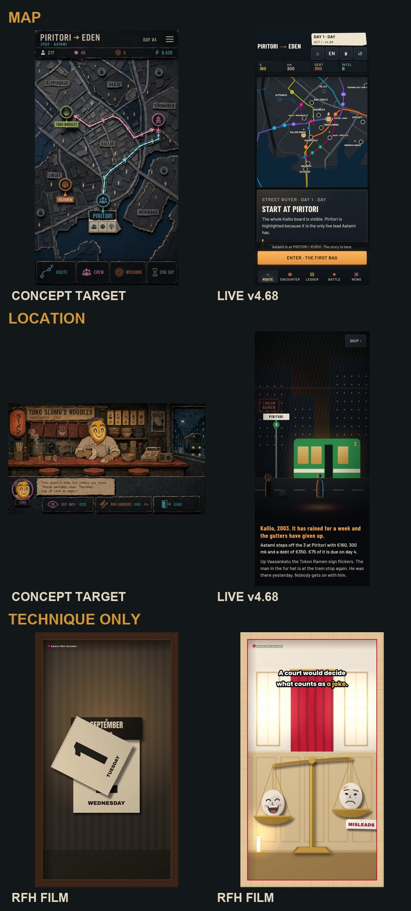

# Art direction — the non-battle overhaul

Status: **plan for owner review**, 2026-10-17. Art lane. No new art is made by
this document.

Owner: *"All non-battle graphics need to be overhauled, see recent paper cut
graphics in Radio Free and the motion graphics side."* Then: *"You have not
been given command to copy the style exactly, your command is to look at the
tech and compare to original concepts and references. Act as a high level Art
Director to plan upgrades according to these."*

So: the **target** is Piritori's own canon — `ART_BIBLE.md` and the approved
`art-library/`. The Radio Free papercut films are a **technique** to borrow,
not a look to copy. Fights are out of scope (they are the 3D track,
[CAMPAIGN.md](../CAMPAIGN.md)); everything around them is in.

*Board 01, phone size: the concept targets
(`art-library/references/ui-target-city-map-v01.jpg`,
`art-library/screens/instances/era1/toko-slomo-noodles-v02.png`), the live
Act I v4.68 map and arrival, and two Radio Free papercut film frames shown for
technique only.*

## 1. The diagnosis

**The concepts are right, and the build drifted away from them.**

| | Concept target | Live Act I (Lantern Noir, v4.56–v4.68) |
|---|---|---|
| Material | cut card, torn kraft, marker, found print | flat vector fills, no paper |
| Map | a relief plan: districts as torn dark card, routes as lit strips | a transit diagram: neon lines on a dark street grid |
| Location | staged frontal interior, dense period props, warm practical light | silhouettes and dotted windows, one flat tram |
| Light | one practical light per scene, warm cards that switch | a gradient and a glow |
| Life | none (still images) | almost none |

Lantern Noir got the *lighting logic* right (dark ground, warm light where the
eye should go, one cool accent for what is yours, plain large type —
`design/UI_LANTERN_NOIR.md`) and should keep it. What it lost is the Art
Bible's north star: *a handmade early-2000s Helsinki, broad cut-card shapes,
torn edges, sparse crooked marker.* By the Art Bible's own sentence test, the
live screens describe as "perfect vector", which is listed as off-target.

The concept images have the opposite problem: they are rich but **static
single images** — no separable layers, no state, no motion, and they cannot
be the runtime (Art Bible rule 5: everything that moves, localises or takes
input stays separable).

## 2. What the papercut technique actually offers

The films (`radiofree/studio/art-motion/scenes/rfp_kit.js` on the Radio Free
films branch, built on the huashu-art-motion engine) are code-drawn. The
technique, separated from its look:

| Technique | What it does | Art Bible clause it serves |
|---|---|---|
| **Sheets with baked shadows** | each layer is a cached canvas card; its soft shadow is blurred once, so a frame is only image draws | §3.3 relief and shadow; rule 5 separable layers; the performance gate |
| **Light follows the camera** | the shadow offset moves with the camera drift and push, so the scene reads as lit, not printed | §6.2 practical lighting |
| **Parallax stack** | each card moves by its own depth; the far ones slightly defocused | depth without 3D cost |
| **Ambient loops** | rain, leaves, flicker, a blinking light — drawn, seeded, repeatable | the semi-approved weather layers (back/mid/front/ground) |
| **Palette per piece** | each film picks its own two loud colours over a dark base | §4.3 colour by mode |
| **Everything is data** | a scene is code plus tokens: localisable, state-switchable, renderable to stills or video | rule 5; trailers and socials for free |

**What the technique does not have, and Piritori needs** — this is where
copying would go wrong:

1. **Edges.** The films cut with perfect geometric paths. The Art Bible wants an
   edge vocabulary: scissor, knife, torn fibre, corrugated, folded corner — one
   dominant per asset (§3.2).
2. **Marker.** The films have no ink. Piritori's identity is sparse crooked
   marker that wobbles, tapers and skips, never the same contour twice (§3.4).
3. **Paper families.** The films use one card "tooth". Piritori distinguishes
   heavy dark card, construction paper, kraft, packaging fragments, newsprint and
   receipt, and vellum glow — each with a job (§3.1).
4. **Two registers.** The films cut everything. Piritori's rule (2026-08-24) is
   that what is cut out is paper and what is never cut (backdrops) is painted night.
5. **Faces.** The films hide faces behind Toko masks — Radio Free's editorial rule.
   Piritori's people have caricature faces in marker (approved heads v03), and
   until models are proven the stand-ins rule (2026-10-02) applies.
6. **The frame.** The wooden shadowbox is Radio Free's brand. Piritori's frame is
   its carton command chrome.
7. **Type.** In-game copy stays live UI (`GODOT_HANDOFF.md`; Art Bible §5), never
   painted into a card.

## 3. The direction in one sentence

> **The concept targets, built the way the films are built:** Piritori's cut
> paper, torn edges and crooked marker, assembled as live layered cards with
> real shadows, practical light and a little weather — in front of a painted
> night that matches the 3D fights.

That last clause ties to the 3D track: a location's painted backdrop can be
**rendered from the same 3D kit the fight uses** (the C.19 courtyard is already
one), so a meeting and the fight it turns into share one place and one light
(the GDD's 2026-09-12 shared-scene ruling).

## 4. Screens in scope, by priority

| # | Screen | Concept target to measure against | Camera family (§6.1) |
|---|---|---|---|
| 1 | **Toko's counter** (Tokon Ramen) | `toko-slomo-noodles-v02.png`, `ui-target-location-toko-v01.jpg` (approved baseline); construction in `STAGE_SPEC.md` §6 | staged frontal |
| 2 | **City map** | `ui-target-city-map-v01.jpg` | relief plan |
| 3 | Arrival opening and story cards | Toko screen materials; Art Bible §8 | staged frontal |
| 4 | Location scenes and the face cut-ins | Karhupuisto plate (approved), location plates in `art-library/locations/era1/` | staged frontal |
| 5 | Command chrome, buttons, crew cards | `art-library/ux-concepts/chrome-carton-test.png`, approved command geometry | UI |
| 6 | Ledger and market | Art Bible §4.3: kraft, receipt white, carbon blue, stamps | UI |
| 7 | Road events, chapter cards, news | §13 channel separation (TV is its own register) | mixed |

Toko's counter goes first because it is the only non-battle screen with an
**approved** target, so the pilot is judged against something agreed, not
against taste.

## 5. Plan

Each step ends in a phone-size side-by-side board — concept target, previous
live, new — and an owner yes before the next.

**AD1 — Material test sheet (the "style test" step).** Built: PR #103,
`art-src/paper-kit/`, boards in `design/art-direction/ad1-*.jpg`.
A Piritori paper kit, owned by this repo and built on the same technique:
paper families × edge vocabulary × marker, in Era I palette tokens (§4.1), lit
by one practical light. One swatch board, no screen. This is what the Radio Free
style tests did before their films; the owner picks before anything is built.

**AD2 — Pilot: Toko's counter, live in Act I.**
*Corrected after checking (2026-10-17):* the counter's construction is already
decided in `STAGE_SPEC.md` §6 (the counter: "the goal reference for
conversations that don't happen on a fight area", owner 2026-08-24). It is
**the painted plate** (`scene-toko-noodles-empty-v01`, delivered 2026-08-27),
**Toko as a 3D layer** (owner: "Toko needs to be a 3D layer for this to work";
a stand-in until proven), and **motion drawn over the plate in code** — tier 0
steam, rain, lamp and tram light, tier 1 the window
(`art-src/prototypes/counter-motion.html` is that tier 0, built). AD2 adds the
AD1 cut-paper band (slab, name plate, choices) and the light that follows the
camera, and wires it into Act I. It does not rebuild the room from cards.
Board: v02 target / today / pilot. The same screen is Arvo's news desk with
different furniture (`STAGE_SPEC.md` §6), so it is built once.

**AD3 — The city map as a relief plan.**
Districts as torn dark card from the real map geometry (`map/`), water as
wet-blue card, routes as lit strips that keep the existing route data and
accessibility (colour never carries a rule alone, §4.2). The least motion of
any screen (§4.3: the map is the most restrained).

**AD4 — Locations and cut-ins.**
Painted night backdrops (from approved plates, or rendered from the 3D kits)
with cut-paper foreground layers, practical lights as switchable cards, light
weather. The meeting-to-fight transition uses the same place.

**AD5 — Chrome, ledger, road, news, chapter cards.**
Carton chrome and kraft/receipt ledger to the Art Bible mode palette; the TV
keeps its own register.

**AD6 — Godot follows.**
Content authored once flows: the web kit exports each scene's layers as images
plus a small layout file; Godot composes them with the same parallax. No second
implementation of the drawing.

## 6. Gates every step must pass

- **The sentence test** (Art Bible §1): "a small number of deliberately cut paper
  pieces, arranged with readable overlap, made specific by a few imperfect
  marker strokes."
- **Texture order** (§3.5): silhouette, colour, overlap, expression, then fibre.
  If the paper grain is noticed before the pose, it is too much.
- **Phone first**: judged at 412 px wide; type and essential strokes legible.
- **Negative space** (§6.3): nothing decorative where a button, face or route is.
- **Motion budget**: ambient only; nothing that moves under a finger; a
  reduced-motion setting turns it off.
- **Performance**: cached cards, measured on the owner's Pixel and iPad.
- **Stand-ins only** for characters until a model is proven (2026-10-02).
- **Not a copy**: no shadowbox frame, no Radio Free palette, no masks as faces.

## 7. Questions for the owner

1. **AD1 first?** A swatch board to choose the paper, edge and marker
   treatment before any screen is touched. (Recommended.)
2. **Backdrops:** painted from the approved plates, or rendered from the 3D
   kits so meetings and fights share one place? (The second ties the game
   together; the first is faster.)
3. **Lantern Noir:** keep its lighting logic and type, and replace its surfaces?
   (Recommended — it is the part that already works.)
